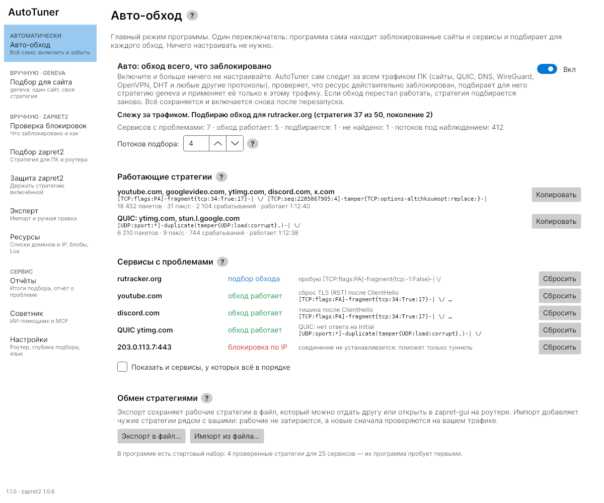

# geneva_c

[Русский](README.md)

A C port of [Geneva](https://github.com/Kkevsterrr/geneva) (Genetic
Evasion). The DPI evasion strategy engine and the genetic strategy search
are one static binary without dependencies. It runs on routers (OpenWrt,
Keenetic/Entware, any Linux with NFQUEUE) and on PCs (Linux, Windows with
WinDivert).

> The project is meant for censorship research and network testing. Follow
> the laws of your country and the rules of the networks you work in.

## Features

- **Geneva's strategy language**: triggers, the actions `duplicate`,
  `fragment`, `tamper`, `drop`, `sleep`, trees for outbound and inbound
  packets. Fields and their semantics follow Geneva (scapy); the
  differences are documented.
- **Engine** (`geneva run`): NFQUEUE on Linux, WinDivert on Windows,
  divert sockets on FreeBSD (ipfw) and OpenBSD (pf). The firewall rules
  (nft, iptables, ipfw or a pf anchor) are set up automatically and removed
  on exit. A control socket, JSON Lines events and live strategy changes.
  Since 1.1 on Windows: an external WinDivert filter (`--filter`,
  `--filter-file`, changed live with `set_filter`), `--first N`, and
  `--priority` for several instances; on Linux `eval`/`evolve --firewall
  none`. A strategy then applies only to the traffic of blocked resources
  (`docs/INTEGRATION.md`).
- **Search** (`geneva evolve`): Geneva's genetic algorithm with saving and
  resuming, a database of found strategies, and parallel evaluation
  (`--workers N`, up to 32 strategies at once). Since 1.2 an external
  controller works in parallel too (`--probe external --workers N`), so a
  program that checks in a browser searches in several threads.
- **Evaluation** (`geneva eval`): `http`, `tls`, `dns`, `tcp` probes, an
  external command or an external controller. Fitness and punishments as in
  Geneva. Success is a complete answer, not a handshake.
- **Server side** (`geneva agent`): strategies on your own server, probes
  from inside the censored network.
- **Library** (`geneva library`): the strategies of Geneva's `library.py`
  with their success rates against the censors of China, India and
  Kazakhstan.
- **Lab censors** (`geneva censor`): Geneva's censors 1–11 and a DNS
  censor, to test strategies on a test bed.
- **Offline** (`geneva apply`, `geneva check`): a strategy over a pcap,
  validation and the canonical form of strategies.

## Where it is used

geneva_c is the engine of the Auto mode in
[Zapret2_AutoTuner](https://github.com/avatarDD/Zapret2_AutoTuner) (a PC,
Windows and Linux) and in [zapret-gui](https://github.com/avatarDD/zapret-gui)
(a router). The program notices blocked services by itself, searches a geneva
strategy for each (`geneva evolve --probe external`, every strategy judged by
a full page load) and applies it to that service's traffic only (`geneva run
--filter` on Windows, its own NFQUEUE rules on Linux). Both programs share
found strategies in one file format (`zapret-gui/geneva-strategies`,
`docs/INTEGRATION.md`).



## How to use: an example

Say `blocked.example` does not open, and you want a strategy for it on a
Linux PC or a router. Everything that changes traffic runs as root.

**1. Check that the site is blocked.** A probe without a strategy (no
privileges needed):

```
$ geneva eval --host blocked.example --probe tls
-360	(no strategy)
```

A positive fitness (`400`) means the site opens and there is nothing to
search for. A negative one tells how it failed: `reset`, `injected` (a
forged answer), `timeout` (silence). The log has the details.

**2. Try Geneva's ready strategies:**

```
$ geneva library -q --test http | sudo geneva eval --host blocked.example --probe tls -f -
-360	\/
398	[TCP:flags:PA]-duplicate(tamper{TCP:dataofs:replace:10}(tamper{TCP:chksum:corrupt},),)-
...
```

Each line is a fitness and a strategy. Strategies with a positive fitness
work.

**3. If none works, search.** Stop with Ctrl+C and continue with
`--resume`; results accumulate in the database:

```
$ sudo geneva evolve --host blocked.example --probe tls --population 50 --generations 20 \
      --checkpoint /opt/geneva/search.ckpt --db /opt/geneva/db.jsonl
398	2	[TCP:flags:PA]-fragment{tcp:8:True}-| \/
$ geneva db --db /opt/geneva/db.jsonl top -n 3
```

**4. Apply the strategy to all traffic on ports 80 and 443:**

```
$ sudo geneva run -s '[TCP:flags:PA]-fragment{tcp:8:True}-| \/' -p 80,443 -c unix:/var/run/geneva.sock
$ sudo geneva ctl stats          # in another terminal: how often it fires
```

Ctrl+C stops the engine and removes the firewall rules.

**5. Make it permanent.** Put the strategy into the file and enable the
service (see "Installation" below):

```
echo '[TCP:flags:PA]-fragment{tcp:8:True}-| \/' > /opt/etc/geneva/strategy.txt   # Entware
sed -i 's/^ENABLED=no/ENABLED=yes/' /opt/etc/geneva/geneva.conf
/opt/etc/init.d/S51geneva start
```

The strategies in the examples are illustrations; what works for you
depends on the DPI of your network.

## Quick start

```
make && make test
build/geneva check '[TCP:flags:PA]-duplicate(tamper{TCP:dataofs:replace:10}(tamper{TCP:chksum:corrupt},),)-| \/'
build/geneva library --country china --test http
build/geneva eval --host blocked.example                  # is it blocked (no privileges)
sudo build/geneva eval --host blocked.example -s '[TCP:flags:PA]-fragment{tcp:-1:True}-| \/'
build/geneva library -q --country china | sudo build/geneva eval --host blocked.example -f -
sudo build/geneva evolve --host blocked.example --workers 8 --checkpoint search.ckpt --db db.jsonl
build/geneva version --json                               # version and build features
build/geneva db --db db.jsonl top -n 5
sudo build/geneva run -s '[TCP:flags:PA]-fragment{tcp:8:False}-| \/' -p 80,443 -c unix:/var/run/geneva.sock
sudo build/geneva ctl stats
geneva.exe run -s '[TCP:flags:S]-duplicate-| \/' -p 80,443 -c tcp:47123   # Windows, as Administrator
```

## Installation

Releases carry binaries for all architectures:
`geneva-VERSION-linux-ARCH.tar.gz` (the static binary, docs and
`packaging/`; x86_64, x86, aarch64, armv7, armv6, armv5, mips, mipsel,
mips64, riscv64, ppc; mips and mipsel are soft-float, as on most routers)
and `geneva-VERSION-windows-ARCH.zip` (x86_64 and x86 with WinDivert from
its official release; arm64 without it, as WinDivert has no ARM64 driver).
Checksums are in `SHA256SUMS`. Building from source needs
only a C compiler (gcc, clang, `zig cc` or mingw):

```
make                                       # for this machine
make STATIC=1 SMALL=1                      # static and small, for a router
make CC="zig cc -target mipsel-linux-musleabi" STATIC=1 SMALL=1
make CC=x86_64-w64-mingw32-gcc            # Windows
make CC="zig cc -target x86_64-freebsd"    # FreeBSD (zig 0.15+), or gmake on FreeBSD itself
```

Linux needs a kernel with NFQUEUE (`nfnetlink_queue`, `xt_NFQUEUE` or
`nft_queue`) and `nft` or `iptables`. On Windows, `WinDivert.dll` and
`WinDivert64.sys` from the
[official release](https://github.com/basil00/WinDivert/releases) go next
to `geneva.exe`. FreeBSD needs the `ipfw` and `ipdivert` modules (`kenv
net.inet.ip.fw.default_to_accept=1; kldload ipfw ipdivert`, or ipfw blocks
everything by default). On OpenBSD `/etc/pf.conf` must contain the line
`anchor "geneva/*"`. Details: `docs/EXT.md`, section X13b.
On Android the static Linux builds work (root, a kernel with NFQUEUE);
give `eval`/`evolve` addresses with `--ip`, since Android has no
`/etc/resolv.conf` (`docs/EXT.md`, section X13c).
On Windows `run --ext` runs in a sandbox once started, as winws2 does:
Low integrity, no privileges, no child processes (`--ext-sandbox 0`
turns it off; `docs/EXT.md`, section X13d).

Service scripts are in `packaging/`:

| System | Files | Where |
|---|---|---|
| OpenWrt (procd) | `openwrt/geneva.init`, `openwrt/geneva.config` | `/etc/init.d/geneva`, `/etc/config/geneva`; the binary in `/usr/bin/geneva` |
| Entware (Keenetic etc.) | `entware/S51geneva`, `entware/geneva.conf`, `entware/010-geneva.sh` | `/opt/etc/init.d/`, `/opt/etc/geneva/`, `/opt/etc/ndm/netfilter.d/` (Keenetic); the binary in `/opt/bin/geneva` |
| Linux (systemd) | `systemd/geneva.service`, `systemd/geneva-agent.service`, `systemd/geneva.conf` | `/etc/systemd/system/`, `/etc/geneva/`; the binary in `/usr/local/bin/geneva` |
| OpenRC (Alpine, Gentoo) | `openrc/geneva`, `openrc/geneva.confd` | `/etc/init.d/geneva`, `/etc/conf.d/geneva`; the binary in `/usr/bin/geneva` |
| SysV init (Debian, Devuan) | `sysv/geneva`, `sysv/geneva.default` | `/etc/init.d/geneva`, `/etc/default/geneva`; the binary in `/usr/bin/geneva` |
| runit (Void) | the directory `runit/geneva` (`run`, `finish`, `conf`, `log/run`) | `/etc/sv/geneva`, then `ln -s /etc/sv/geneva /var/service/` |
| s6 | the directory `s6/geneva` (`run`, `finish`, `conf`, `type`) | an s6 scan directory or s6-rc source |

The strategy lives in a file (one line, by default
`/etc/geneva/strategy.txt` or `/opt/etc/geneva/strategy.txt`). Enable the
service in its config (`enabled`/`ENABLED`; with OpenRC, runit and s6 in
the service manager itself). `reload` (`sv hup geneva`, `s6-svc -h`)
re-reads the strategy without dropping connections; `stop` (`sv down`,
`s6-svc -d`) removes the firewall rules. Under runit and s6 geneva waits
for a strategy in the file, checking it every few seconds.

## Documentation

The documents are in Russian.

| Topic | File |
|---|---|
| strategy language and differences from Geneva | `docs/STRATEGY.md` |
| engine, firewall rules, Windows | `docs/ENGINE.md` |
| events, control socket, exit codes | `docs/PROTOCOL.md` |
| probes, fitness, evaluator | `docs/EVAL.md` |
| search, checkpoints, database | `docs/EVOLVE.md` |
| server side and `geneva agent` | `docs/SERVER_SIDE.md` |
| lab censors and the test bed | `docs/CENSOR.md` |
| embedding in zapret-gui and Zapret2_AutoTuner | `docs/INTEGRATION.md` |
| work plan | `docs/PLAN.md` |
| `--ext` extensions: what is done so far (Russian) | `docs/EXT.md` |
| `--ext` design: parity with zapret2, autonomous adaptation (Russian) | `docs/EXT_ROADMAP.md` |
| version history | `CHANGELOG.md` |

A reference for AI agents that work on this repository or embed geneva:
`.claude/skills/geneva/SKILL.md` (in English).

## Tests

```
make test                                  # unit tests
sudo tests/e2e/run.sh build/geneva         # the engine in network namespaces
sudo tests/e2e/censors.sh build/geneva     # censors, search, server side
sudo tests/e2e/initscripts.sh build/geneva # service scripts
```

## License

BSD 3-Clause, like Geneva. Geneva: Copyright (c) 2020, University of
Maryland College Park. The strategy library (`src/library_data.h`) is
generated from Geneva's `library.py` by `tools/gen_library.py`.
